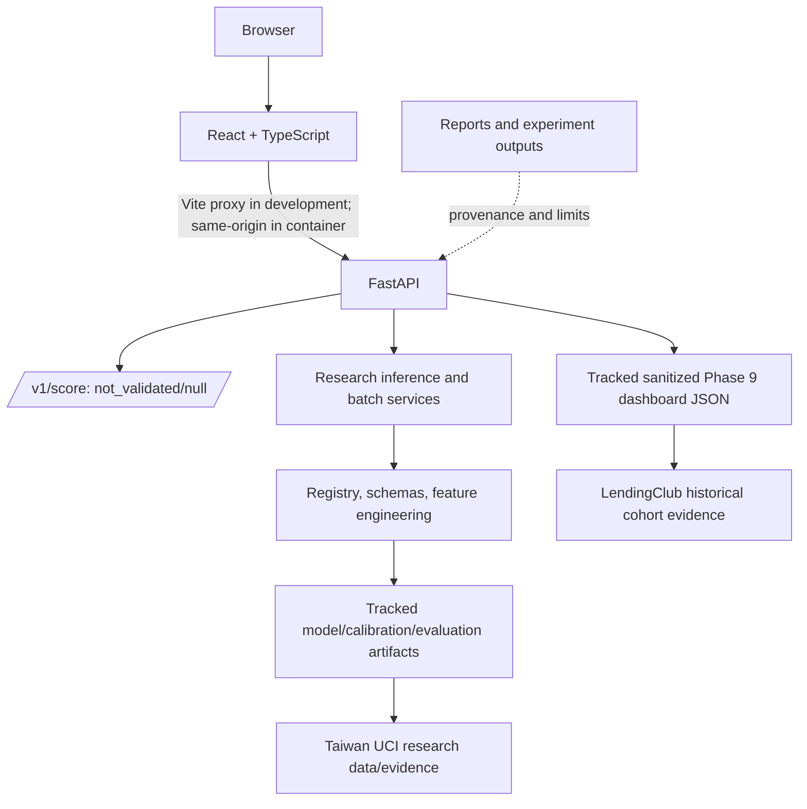

# CreditAI Master Handbook and Pre-Deployment Audit

**Audit date:** 1 November 2026
**Current branch candidate:** `phase11-final-verification` at `e03e91926f2242e4126edc68708f924e4687a1d5`.
**Purpose:** one-source project, safety, evidence, and handoff guide for the current research/demo system. This is preparation for Azure architecture and cost planning, not production lending validation or deployment approval.

## READ THIS FIRST — AI / Developer Safety Rules

1. Taiwan models are research/demo only; do not claim Indian borrower validation.
2. `/v1/score` returning `not_validated` and `default_probability: null` is intentional. Do not connect it silently to a Taiwan model.
3. Do not casually retrain, replace, or suppress warnings for the shipped calibration artifact. Its original provenance is unknown.
4. `1 - PD` is a mathematical complement, not guaranteed repayment or approval probability.
5. SHAP/contributions describe model attribution, not causality.
6. Never fabricate ROC, calibration, threshold, borrower-level, or monitoring evidence.
7. Preserve currency context: Taiwan NT$, LendingClub USD, synthetic Indian demo INR. No conversion is implied.
8. Historical dashboard data are not live production traffic.
9. Do not merge or deploy without explicit authorization.
10. Preserve unrelated untracked files in this checkout.
11. Verify source and evidence before changing scientific claims.

## Executive Summary and Product Boundary

**Product vision:** future ML-assisted credit-risk infrastructure for financial institutions/NBFC-type use cases, potentially based on authorized borrower financial data and observed repayments.

**Current implementation:** a pre-deployment research workbench. It presents historical LendingClub cohort evidence, Taiwan UCI research inference and evaluation, batch analysis, synthetic demonstrations, and evidence/readiness gates.

**Not validated:** real Indian borrowers, Indian lending decisions, transfer from Taiwan/U.S. data, production decision thresholds, regulated use, or production monitoring. CreditAI is not a CIBIL replacement, RBI-approved scoring system, loan approval/rejection engine, repayment guarantee, or deployed production monitoring system.

**Readiness conclusion:** ready to begin Azure architecture and cost planning for a clearly labeled research/demo deployment. It is not ready for production lending. Docker build/runtime, Azure architecture, cost and provider selection have not been verified or authorized. No Azure resource or production deployment was made.

## Source-Control and Freeze Baseline

| Item | Verified state |
|---|---|
| Local branch / HEAD | `phase11-final-verification` / `e03e91926f2242e4126edc68708f924e4687a1d5` |
| Remote verification branch | `origin/phase11-final-verification`, same SHA |
| Remote `main` | `b8ff9cad5226cab80c6712eb65c3d576c024363b` |
| Ahead/behind | `git rev-list --left-right --count origin/main...origin/phase11-final-verification` → 0 behind, 8 ahead |
| PR | [#1](https://github.com/vashisth8246/CreditAI/pull/1), open, not merged; base `main` |
| Start-of-audit tracked changes | None staged or modified |
| Start-of-audit unrelated untracked files | Listed below; preserved |
| `git diff --check` | Passed before this handbook was created; rerun after editing |
| Deployment | Not performed |

Latest applicable CI run [41299626128](https://github.com/vashisth8246/CreditAI/actions/runs/41299626128) was a `pull_request` run with branch head `e03e91926f2242e4126edc68708f924e4687a1d5`. The tested PR merge commit was `e65d497ab2a7721672f00718d68f92d74b1bb194`, with parents current `main` and the branch head. Thus the package artifact corresponds to the PR merge ref, not a merge of the PR into `main`. PR remains open/unmerged.

Pre-existing untracked files at audit start; these were not changed or added here:

```text
PHASE_11_FULL_REPORT.md
check_batch.py
docs/RENDER_DEPLOYMENT.md
frontend/public/data/phase_10_dataset_inventory.json
frontend/public/data/phase_6_1_dataset_inventory.json
frontend/public/data/phase_6_1_feature_inventory.json
frontend/public/data/phase_6_1_lendingclub_summary.json
frontend/public/data/uci_taiwan_eval.json
frontend/public/data/uci_taiwan_knn_eval.json
package-lock.json
reports/ci_implementation_report.md
reports/phase_10_completion_report.md
reports/phase_10_dataset_audit.json
reports/phase_10_dataset_audit.md
reports/phase_10_feature_engineering.md
reports/phase_10_knn_configuration.json
reports/phase_10_model_comparison.json
reports/phase_10_model_comparison.md
scripts/train_knn_model.py
```

`frontend/package-lock.json` is tracked and used by CI/Docker. The root `package-lock.json` is untracked and not used by those workflows. Current snapshot API reads tracked Phase 9 JSON, not the untracked Phase 6.1/extra Taiwan JSON. Do not stage unrelated untracked files.

## Architecture



Vite serves development UI at `127.0.0.1:5173` and proxies `/health` and `/v1` to FastAPI at `127.0.0.1:8000`. `frontend/src/api.ts` uses relative same-origin paths by default. Dockerfile builds the frontend, copies `frontend/dist` into a Python image, serves it at `/`, and binds Uvicorn to `0.0.0.0:${PORT:-10000}`. Docker build and container runtime are not verified. Azure services/infrastructure are not implemented.

Batch is a separate FastAPI path. It parses an upload, handles sheets independently, maps to Taiwan's 23 raw fields, validates rows, calls Taiwan XGBoost research inference, and returns summaries/exports. It does not call `/v1/score`.

## Repository Map

| Path | Purpose | Notes |
|---|---|---|
| `src/api/` | FastAPI routes/contracts and batch service | Runtime-critical; health/status, snapshots, research, batch, export, safe score route, static frontend mount. |
| `src/inference/` | Registry, schemas, validation, predictor, explanations | Runtime-critical for Taiwan research inference. Model paths are relative to CWD. |
| `src/calibration/` | Platt calibrator implementation | Defines class used by serialized calibrator. |
| `src/models/knn.py` | KNN explanation class | Needed when unpickling KNN bundle. |
| `src/data/`, `src/features/`, `src/research/`, `src/evaluation/`, `src/qualification/`, `src/temporal_audit/` | Data/research utilities | Primarily reproducibility, experiment and evidence code. |
| `models/` | Tracked joblib models, calibrators, feature names, metadata and evaluation JSON | Runtime artifacts; raw data is not stored here. |
| `frontend/src/` | Dashboard pages, API client, prediction/batch UI and styles | Runtime-critical frontend source. |
| `frontend/public/data/` | Static sanitized dashboard source files | Three tracked `phase_9_*` JSON files are used by snapshot API. |
| `scripts/` | Training, data acquisition, packaging, deployment and evaluation scripts | Release and UCI SHA verification scripts are tracked. `scripts/train_knn_model.py` is untracked. |
| `tests/` | API, batch, pipeline and research tests | CI runs `tests/` on Ubuntu/Python 3.11. |
| `reports/phase11/` | Saved metrics, splits, run metadata, reliability, selective review and SHAP outputs | Experiment run metadata records a dirty source worktree. |
| `reports/`, `docs/phase11/` | Historical reports and detailed verification | Evidence and handoff; not all files are runtime inputs. |
| `.github/workflows/ci.yml` | Backend/frontend checks, release package and guarded deployment | Deployment branch/provider gates described below. |
| `Dockerfile`, `.dockerignore` | Multi-stage image and deny-by-default build context | Present; Docker not built in this audit. |
| `Data/` | Local/raw datasets and workbooks | Ignored by Git and excluded from release. |
| `release/`, `logs/`, `.venv/`, `frontend/node_modules/`, `frontend/dist/` | Local/derived state | Ignored/excluded; CI downloads tested frontend artifact for package job. |

## Dataset Inventory and Provenance

### Active research data: Taiwan UCI

`reports/phase11/run_metadata.json` records the UCI *Default of Credit Card Clients* dataset: 30,000 rows; 25 source columns (23 predictors, ID and target); no missing values; target `default payment next month`; 6,636 defaults / 23,364 non-defaults (22.12%). Data describe Taiwan credit-card clients with billing/payment history from April–September 2005 and a next-month default target. Seed 42 stratified split is 21,000 train / 4,500 validation / 4,500 locked test.

The local ignored workbook `Data/credit_default/default of credit card clients.xls` exists and matched SHA-256 `21b3cf4e30878150ae8db9386780e23febb613921747dec9e59dccb32f6104d3`. Tracked `scripts/fetch_phase11_dataset.py` verifies this hash before storing the workbook under ignored `Data/`; clean-machine download was not exercised during this audit. Experiment metadata records source commit `932c63f98ab5de87c32ba08d4ded55068324ef55` and `worktree_was_dirty: true`; therefore the historical run's commit does not identify every uncommitted byte that may have influenced it. This is a documented reproducibility limitation.

### Historical dashboard data: LendingClub / U.S.

The dashboard's tracked Phase 9 JSON files contain sanitized aggregate summaries, inventory and feature metadata derived from historical LendingClub accepted loans, origination 2007–2018Q4. The snapshot reports 2,260,701 source rows; 1,348,099 closed loans; 269,360 terminal defaults; 19.98% among closed outcomes. Active/censored statuses are excluded from this closed-outcome cohort. This variable-horizon terminal outcome is not fixed-horizon PD. The local-copy source provenance/commercial rights remain unverified. It is not the active Taiwan inference dataset.

### Other datasets and synthetic inputs

The discovery inventory includes German Credit DS004/DS005, UCI Credit Approval DS006, CreditMitra UPI narration DS007, NPCI/RBI aggregate series DS014–DS017, and external candidates EXT001–EXT003. These are not current active score inputs. Their reports classify them as review-required, blocked, damaged, not acquired, or lacking suitable borrower outcomes/temporal evidence. Do not imply they validate Indian borrowers.

Phase 1 and 1.1 synthetic transactions, borrowers and outcomes test software/data pipelines and demo flows. Synthetic outcomes are generated, not observed defaults. Synthetic Indian product examples demonstrate display/workflow only and do not validate the underlying model.

| Dataset/artifact | Geography | Real or synthetic | Role | Currency/context | Validation use and status |
|---|---|---|---|---|---|
| UCI Default of Credit Card Clients / DS003 | Taiwan | Real, historical | Active XGBoost/KNN research and evaluation | NT$; credit-card history Apr–Sep 2005, next-month target | Taiwan historical benchmark only; not India validated |
| LendingClub accepted loans / DS001 | U.S. | Real, historical | Dashboard cohort and portfolio summaries; historical model evidence | USD; origination 2007–2018Q4 | Closed-loan terminal outcome, variable horizon; local rights caveat |
| Phase 1/1.1 synthetic tables | Synthetic | Synthetic | Pipeline tests and demo | INR only when UI explicitly presents a synthetic Indian example | No real-world validation |
| German Credit / UCI Credit Approval | Germany / historical | Real historical | Discovery inventory; not active scoring | Source-specific | Proxy/old labels; review-required or blocked |
| CreditMitra UPI narrations | India | Local financial data | Inventory only | Indian transaction context | No repayment target/permission established; blocked |
| NPCI/RBI aggregates | India | Real aggregate | Discovery/macro context | Aggregate values | Not borrower-level training/validation |
| EXT001–EXT003 candidates | Various | Remote metadata only | Discovery candidates | Varies | Not acquired/inspected as approved model data |

### Currency provenance

| Context | Currency |
|---|---|
| Synthetic Indian product/demo | INR / ₹ |
| Taiwan research model | NT$ |
| LendingClub historical views | USD / $ |

No automatic exchange-rate conversion is implied.

## Feature Engineering and Model Inventory

Taiwan inference accepts 23 raw fields: `LIMIT_BAL`; `SEX`, `EDUCATION`, `MARRIAGE`, `AGE`; `PAY_0`, `PAY_2`–`PAY_6`; `BILL_AMT1`–`BILL_AMT6`; and `PAY_AMT1`–`PAY_AMT6`. The deterministic inference function computes 27 engineered fields for a 50-feature vector: six utilization ratios, average/maximum utilization, six pay-to-bill ratios and their average, delinquency maximum/mean/count/recent flag/two trends, recent bill change, bill growth over limit, payment-month count, total pay/total bill, payment standard deviation, and timely-payment count. Division denominators are floored at 1.0. Input schema validation enforces required keys, types, categories/ranges and rejects unknown keys. Batch missing values are reported, not silently imputed. Features are supplied to the model in stored feature-name order.

| Model | Purpose / data | Calibration | Current runtime role | Status |
|---|---|---|---|---|
| Logistic Regression | Phase 11 comparison; Taiwan; `StandardScaler`, balanced classes, max_iter 1000 | Raw, validation-fit Platt and isotonic evaluated | No current registered serialized inference model | Research comparison |
| Random Forest | Phase 11 comparison; Taiwan; 200 trees, depth 10, min leaf 20, balanced | Same experiment comparison methods | No current registered serialized inference model | Research comparison |
| XGBoost | Phase 11 comparison; Taiwan; 300 estimators, depth 5, learning rate .05, subsample/column sample .8, training-derived positive weight | Experiment calibrators fit on validation; serving registry separately points to shipped calibrator | Registered as `uci_taiwan_xgb`, Prediction initial choice, Batch default | Research/demo only |
| KNN | Taiwan comparison/runtime bundle | `calibration_knn_model.joblib` | `uci_taiwan_knn`; KNN uses `src/models/knn.py` at load time | Research/demo only; retraining script is untracked |
| Synthetic/legacy risk engine | Earlier synthetic pipeline | Separate legacy metadata/artifacts | Not the current registered research API; `/v1/score` does not load it | Never treat as production validated |

The comparison does not prove one universal best model. The saved numbers show Random Forest highest ROC-AUC, XGBoost highest Average Precision, and Random Forest + Platt best Brier/log-loss/ECE combination. “XGBoost is best overall” is unsupported.

## Phase 11 Research Evidence

Values are rounded to four decimals from `reports/phase11/probability_metrics.json`; its CSV counterpart matches. Each row is a locked-test evaluation.

| Model | Method | ROC-AUC | Average Precision | Brier | Log loss | ECE (10 equal-width bins) |
|---|---|---:|---:|---:|---:|---:|
| Logistic Regression | Raw | 0.7550 | 0.4903 | 0.1934 | 0.5804 | 0.2175 |
| Logistic Regression | Platt | 0.7550 | 0.4903 | 0.1436 | 0.4518 | 0.0124 |
| Logistic Regression | Isotonic | 0.7514 | 0.4733 | 0.1440 | 0.4553 | 0.0133 |
| Random Forest | Raw | 0.7816 | 0.5568 | 0.1756 | 0.5339 | 0.1917 |
| Random Forest | Platt | 0.7816 | 0.5568 | 0.1349 | 0.4288 | 0.0083 |
| Random Forest | Isotonic | 0.7803 | 0.5371 | 0.1351 | 0.4504 | 0.0123 |
| XGBoost | Raw | 0.7807 | 0.5588 | 0.1709 | 0.5205 | 0.1696 |
| XGBoost | Platt | 0.7807 | 0.5588 | 0.1355 | 0.4305 | 0.0145 |
| XGBoost | Isotonic | 0.7800 | 0.5394 | 0.1359 | 0.4451 | 0.0111 |

The runner uses seed 42 and stratified 70/15/15 train/validation/test splits (21,000/4,500/4,500); metadata records each split-index hash and dataset hash. Python 3.11.9, NumPy 2.4.6, pandas 3.0.6, scikit-learn 1.9.1, XGBoost 3.2.0, SHAP 0.51.0 are recorded. Current source audit found model configuration and calibrator fitting on train/validation as expected; model comparison configurations are fixed in the runner, and locked test is used for final metrics rather than fitting or selecting the review margin. This source-path check cannot rule out undocumented exploratory human choices before the recorded run.

ECE bins probabilities into 10 equal-width `[0,1]` intervals, puts `p=1` in the last bin, omits empty bins, then computes the sample-count-weighted absolute difference between bin observed rate and average predicted probability.

### Selective review

The saved margin is `m=0.20` around research class threshold `0.50`. Refer when `abs(p - 0.50) < 0.20`; accept when `abs(p - 0.50) >= 0.20`; accepted class is `p >= 0.50`. Margin selection uses validation candidates meeting at least 80% validation coverage and minimizes accepted-set error (tie breaks: greater coverage, then smaller margin). Validation accepted 3,655/4,500 (81.22%), referred 845, with 505 accepted errors (13.82%). Test accepted 3,611/4,500 (80.24%), referred 889 (19.76%), with 473 accepted errors (13.10%). This is confidence-based referral, not full epistemic uncertainty or a guarantee of safe lending decisions.

### SHAP robustness study

Saved experiment used `shap.TreeExplainer`, first 100 fixed test rows, 12 selected features, seed 42 and one-feature-at-a-time empirical marginal replacement from training columns (1,200 perturbations). The grouped summary recalculates to average absolute-SHAP rank Spearman `0.9671` and mean top-10 Jaccard `0.8893`. Marginal perturbations can create implausible joint feature combinations; this is narrow sensitivity evidence, not causality, universal stability or external validation.

### Threshold evidence

`scripts/generate_evaluation_artifacts.py` generated the saved threshold sweep from locked-test labels. It cannot be presented as validation-selected operating evidence. The Model Performance Lab withholds a threshold curve because validation score/label data are not saved for this purpose. A `0.50` cutoff in research inference is only a research classification threshold. Validation-selected model threshold, business operating threshold, and lending decision threshold are distinct and require their own evidence and governance.

## Calibration and Probability Semantics

Read-only inspection of tracked `models/calibration_model.joblib` found class `src.calibration.calibrate.PlattCalibrator`, slope `0.47414481616618126`, intercept `-1.2645029152597382`, SHA-256 `6b94f41d3521c37e22d41b91e505006f1c737d022c214f803a5b9a057f185cdc`. Loading emitted an unsuppressed scikit-learn warning: serialized LogisticRegression version 1.9.0, runtime 1.9.1. A separate documented fresh fit gives different parameters (slope 0.85795861, intercept -1.09014010). Original training run/data provenance is unknown. Do not replace the artifact without a separately justified, reviewed change. The nine Phase 11 comparison rows are not proof that this shipped calibrator has the same fitted provenance.

**PD** is the estimated probability of the dataset-defined target in that model context. For example, `PD = 0.082` means an 8.2% model estimate for the Taiwan next-month target, not an India borrower PD. **Non-default complement** is `1 - PD`: `1 - 0.082 = 0.918` (91.8%). It is arithmetic, not guaranteed repayment, approval probability or a trust score.

`src/inference/explanations.py` uses TreeExplainer for tree models. Positive class-1 contribution means risk-increasing; negative means risk-decreasing. UI magnitude is absolute contribution in model-output units, not percentage points. Attribution is not causality. KNN uses local-neighbor variance attribution, not SHAP. Missing explanation output is not fabricated. LendingClub cohort metrics do not supply individual borrower explanations.

## Backend/API Manual

FastAPI entrypoint is `src.api.app:app`. Routes inspected in `src/api/app.py`:

| Route | Method | Function and status | Safety note |
|---|---|---|---|
| `/health` | GET | `status: ok`, `scoring: not_validated` | Liveness only, not model approval. |
| `/v1/build` | GET | Full release commit SHA and short form when configured; otherwise null | Release identity only; scoring remains `not_validated`. |
| `/v1/status` | GET | Connectivity, registered count, research inference readiness, Indian production status | Registry availability is not validation. |
| `/v1/dashboard/snapshot` | GET | Sanitized tracked Phase 9 LendingClub summary, inventory and feature JSON with retrieval time | Historical source, not live activity. |
| `/v1/models` | GET | Registered model list | Taiwan research models. |
| `/v1/models/{model_id}` | GET | Model metadata and artifact availability | Historical metrics/metadata remain scoped. |
| `/v1/models/{model_id}/schema` | GET | Input schema and engineered-feature names | Taiwan units include NT$. |
| `/v1/models/{model_id}/evaluation` | GET | Saved XGBoost/KNN evaluation JSON | Historical held-out evidence; test-derived threshold sweep not operating evidence. |
| `/v1/predict` | POST | Single-row research inference | Not production or Indian validated. |
| `/v1/research/taiwan/batch/inspect` | POST multipart | File/sheet inspection and row validation | 10 MiB bounded upload. |
| `/v1/research/taiwan/batch/analyze` | POST multipart | Revalidation after sheet/column mapping | No implicit sheet concatenation. |
| `/v1/research/taiwan/batch-predict` | POST multipart | Scores selected Taiwan workbook sheets | Uses research XGBoost model, not `/v1/score`. |
| `/v1/research/taiwan/batch/export/csv` | POST JSON | Formula-safe prediction CSV | Row-level provenance/errors are preserved. |
| `/v1/research/taiwan/batch/export/xlsx` | POST JSON | Predictions/Summary workbook; max 20,000 rows | Formula-safe output. |
| `/v1/score` | POST JSON | Strict transaction schema validation then no-score response | Always `not_validated`, `score_type: none`, probability null; invokes no model. |

The score contract enforces schema version/date/window, unique transaction IDs, allowed types, finite positive amounts, and rejects unknown fields. This is intentionally safety-locked because no production/India-validated model is authorized. The null must not be “fixed” by wiring in the Taiwan model.

## Frontend Manual

React 19 + TypeScript 6 + Vite 8. Frontend tests use Node 24's direct TypeScript strip-types support. The pages below were manually reviewed at 100% on desktop 1440×900 and at 390×844 narrow size. Horizontal nav scroll is intentional; charts/tables scroll within their panels. A one-pixel mobile Batch Evaluation overflow measurement remained (subpixel rounding). Browser showed a Vite HMR WebSocket warning; page/API HTTP behavior worked.

| Page | Purpose, controls and source | Evidence/limitations | Runtime result |
|---|---|---|---|
| Executive Overview | Historical KPIs/charts and U.S. model comparison from `/v1/dashboard/snapshot` | LendingClub closed-loan terminal outcomes; not live production metrics | Render/data/safety reviewed — PASS |
| Borrower Prediction | Choose registered model, enter Taiwan fields, validate/submit, inspect PD/complement/class/threshold/5W/drivers | Taiwan 2005 next-month target; NT$; not Indian validation | Synthetic profile and result semantics reviewed — PASS |
| Batch Evaluation | CSV/XLS/XLSX upload, sheet/mapping, validation, scoring, filters, explanations, charts, exports | Taiwan XGBoost research-only | CSV and 7-sheet XLSX plus exports reviewed — PASS |
| Data Discovery | Search/filter dataset inventory and inspect readiness evidence | Inventory qualification is not validation approval | Status/detail behavior reviewed — PASS |
| Portfolio Intelligence | Historical U.S. cohort and segments, distributions/correlation | LendingClub USD; association is not causation | Tables/charts/responsiveness reviewed — PASS |
| Model Lab | Historical saved model metrics and split/target evidence | No genuine plot when coordinate data are absent | Evidence reviewed — PASS |
| Model Performance Lab | Select Taiwan XGBoost/KNN; saved ROC/calibration curves and metrics | Genuine held-out coordinates; threshold plot withheld | Model data/caveat reviewed — PASS |
| Risk Explorer | Historical evidence plus clearly simulated future workflow; separate score contract check | Simulated India flow is UI-only, no real decision | `/v1/score` checked: not_validated/null — PASS |
| Explainability | Shows available model explanation evidence and gaps | LendingClub aggregate stats do not yield individual explanations | Scope reviewed — PASS |
| Monitoring | Future gates and historical data context | No production traffic, PSI/drift result or matured labels | Future-state wording reviewed — PASS |
| Architecture & Audit | System flow and evidence roadmap | India outcomes, commercial rights and deployment monitoring remain gates | Safety lock/gates reviewed — PASS |

### Prediction and 5W usage

The dashboard header shows the short deployed commit when the hosting pipeline supplies it; the full SHA is available from `/v1/build`. This identifies the software release only and says nothing about model validation. To use the prediction page, choose a research model (default `uci_taiwan_xgb`), enter its 23-field profile, validate, submit, and read PD as the Taiwan target estimate. The 0.50 comparison is a research classification, not lending policy. Then read `1-PD`, the five-W context and feature drivers; use Taiwan NT$ units. Friendly labels map to model keys such as `LIMIT_BAL`, `PAY_0`, `BILL_AMT1`, `PAY_AMT1`.

5W: **What** model target; **Why** contributing features; **Who** the submitted profile is (synthetic/research, not a validated Indian borrower); **When** only target timing supplied by source (next month); **Where/Data** Taiwan/UCI/model version. Do not invent missing horizons.

### Batch user guide

CSV, XLS and XLSX are supported. Upload and inspect first; choose sheets and review automatic header mapping, then map any unmatched columns explicitly, inspect row-level validation, and run scoring only on usable selected sheets. Sheets are independent and never auto-concatenated. Extra metadata columns are not passed to the model. Missing values are rejected rather than imputed. XLSX formulas in required fields are rejected due stale cached values; formula detection is unavailable for `.xls` and disclosed. Text numerics may be coerced with warnings.

Limits: 10 MiB upload, 5,000 rows/sheet, 20 sheets, 200 columns, 400 characters/cell; errors/warnings are bounded. Duplicate borrower-reference values create warnings but rows are retained. The seven-sheet synthetic acceptance workbook uses `Portfolio_A` valid, `Portfolio_B` reordered valid, `Portfolio_C` missing required data, `Portfolio_D` valid plus extra metadata, `Invalid_Sheet`, `Summary`, and `Empty_Sheet`. A/B/D were scoreable after selection; invalid/unmapped and empty sheets were not automatically scored.

Per-row output retains reference, sheet and source row, status/error, model, PD, complement, research category, threshold, drivers and available submitted features. Summary covers total/scored/errors, mean/median over successful rows, risk distribution and histogram/examples. CSV/XLSX exports include explanations/context/limitations; validation errors export separately. XLSX has `Predictions` and `Summary`; formula-injection neutralization is implemented. Manual runtime flow confirmed provenance and rejected-row reasons in outputs.

### Data/evidence and system pages

Data Discovery uses Research Ready, Available — Restricted Use, Evidence Gap, Synthetic / Demo, Needs Review and Source Unavailable. A gap is not necessarily a runtime error. Portfolio Intelligence is historical LendingClub USD; its correlations are not causality. Model Performance's ROC/calibration plots use saved held-out coordinates only; no fake curves. ROC-AUC measures ranking, Average Precision is useful under imbalance, Brier/log-loss are probability quality, ECE summarizes calibration discrepancy. Risk Explorer's synthetic example is not a separate scoring API. Monitoring has no production drift data. Architecture & Audit gates include India outcomes, data rights, monitoring/production traffic, and `/v1/score` lock.

## Test, CI, Runtime and Release Record

### Tests/checks

| Check | Latest evidence | Result and limitations |
|---|---|---|
| Frontend tests | Local `npm test`; CI 41421039804 | PASS: local 36 passed, 0 failed, 0 skipped; CI job passed. |
| Frontend lint | Local `npm run lint`; CI 41421039804 | PASS, exit 0. |
| TypeScript | Local `node node_modules/typescript/bin/tsc -b`; CI `npx tsc -b` | Direct local command and Linux CI PASS. Local `npx tsc -b` fails on the Windows `&` workspace path; CI is unaffected. Do not weaken CI. |
| Production build | Local `npm run build`; CI 41421039804 | PASS; Vite production frontend artifact uploaded. |
| Backend API contract | `pytest tests/test_api_contract.py -v --tb=short` | PASS locally, 9 passed. |
| Full backend suite | CI Backend Tests job | PASS in run 41421039804. Local focused Azure adapter tests 7 passed; build identity contract 1 passed. Local Windows full-suite TestClient limitation remains. Exact CI test/skip counts were not obtained from logs here. |
| Batch | Current synthetic runtime flow; prior test/resolution reports; CI backend job | CSV and synthetic XLSX upload/inspect/predict/exports exercised; backend CI pass. Windows HTTP TestClient stall remains local limitation. |
| Research | Saved CSV/JSON and source audit | Metrics match each other; experiment not rerun in this audit. Metadata says original run worktree dirty. |
| Whitespace | `git diff --check` | Passed after the Azure CD implementation and handbook evidence update. |

### GitHub Actions and package

`.github/workflows/ci.yml` triggers on pushes to `main` and PRs targeting `main`; permissions default `contents: read`. Backend and frontend jobs are required by packaging. Frontend job uses Node 24, `npm ci`, test, lint, TypeScript and production build, and uploads `frontend-dist-${github.sha}`. Package job downloads that tested build and packages tracked `src/`, `models/`, `requirements.txt`, frontend output and `build-manifest.json`. The manifest records SHA and `scoring_status: not_validated`. The release ZIP is commit-addressed; the same downloaded artifact is deployed if a future deploy job is enabled. Package script checks clean tracked status and all registered model paths.

Run 41299626128: Backend Tests PASS; Frontend Tests/Lint/TypeScript/Build PASS; Package Immutable Release PASS; Deploy and Verify SKIPPED; Deployment Pending Provider Selection SKIPPED. No deployment. Artifacts present and unexpired when checked: `frontend-dist-e65d497ab2a7721672f00718d68f92d74b1bb194` and `creditai-release-e65d497ab2a7721672f00718d68f92d74b1bb194`. The artifact names use the PR merge SHA `e65d...`; the branch HEAD is `e03e...`. This audit did not download/unzip these artifacts independently and did not create a local ZIP from this workspace.

After the Azure CD implementation, PR run [41421039804](https://github.com/vashisth8246/CreditAI/actions/runs/41421039804) passed on branch commit `db5d812fbbf0a03bbea07d60f63a3b96abf4efcb`: Backend Tests, Frontend Tests/Lint/TypeScript/Build, and Package Immutable Release all PASS. The workflow parsed and ran in GitHub Actions. `Deploy and Verify` and `Deployment Pending Provider Selection` were SKIPPED because this was a pull request. The successful package artifacts were `frontend-dist-cc599596dffc810cdcb9197d670c2eac4ddbf69d` and `creditai-release-cc599596dffc810cdcb9197d670c2eac4ddbf69d`. This run does not verify Azure login, container image build/push, or a live deployment.

Deployment `if` conditions only permit a push to `refs/heads/main`; PRs cannot deploy. Deployment needs all three prior jobs to succeed and uses GitHub `production` environment. With `vars.DEPLOYMENT_PROVIDER` empty on a main push, pending-provider job records pending and does not deploy. Unknown IDs fail adapter validation. As of the Azure CD update, `PROVIDER_ADAPTERS` registers the Azure Container Apps implementation. It uses GitHub OIDC, builds a container image from the immutable release ZIP's already-tested frontend and backend/model files, pushes a full-SHA tag to ACR, and updates an existing Container App. It sets `CREDITAI_BUILD_SHA`; `/v1/build` reports the deployed source SHA, the dashboard header shows its short form, and the deploy job verifies it equals the intended release. The job also checks `/health` and `/v1/status` and preserves the `not_validated` contract. No Azure resources, identity, GitHub production secrets/variables, or public Azure URL have been configured or verified in this workspace, so no deployment has occurred. The Azure workflow is not live-enabled until the documented settings are supplied. Production environment's external reviewer/branch protection settings were not independently verified.

Previously documented non-blocking warnings in run 41286784346 included Node.js 20 action runtime deprecation notices and an informational `ubuntu-latest` migration. This audit did not establish whether the same warning text appeared in 41299626128. They did not invalidate the recorded successful CI run.

## Local Development, Configuration, Dependencies and Troubleshooting

### Windows PowerShell

From repository root with Python 3.11:

```powershell
py -3.11 -m venv .venv
.\.venv\Scripts\Activate.ps1
python -m pip install -r requirements.txt
python -m uvicorn src.api.app:app --reload --host 127.0.0.1 --port 8000
```

Run from repo root so `models/...` relative paths resolve. Backend URL: `http://127.0.0.1:8000`.

In a second terminal:

```powershell
Set-Location frontend
npm ci
npm run dev -- --host 127.0.0.1
```

Frontend URL: `http://127.0.0.1:5173`; Vite proxies `/health` and `/v1` to backend. `.env.example` files are examples only and are not auto-loaded.

### Dependency/configuration table

| Configuration/dependency | Development / requirement | Hosting note |
|---|---|---|
| Python | 3.11 in GitHub workflow and Dockerfile; local evidence CPython 3.11.9 | Pin/verify chosen image. |
| Node | 24 in CI and Docker build | Use tracked frontend lockfile with `npm ci`. |
| Python packages | `requirements.txt`: broad minimum versions, scikit-learn pinned 1.9.1 | Research exact environment snapshot is `requirements-phase11.lock.txt`; CI currently installs main requirements. |
| `PORT` | Local 8000; Docker default 10000 | Host supplies port; bind `0.0.0.0`. |
| `CORS_ORIGINS` | Empty for same-origin Vite proxy | Exact HTTPS origins only for split hosting. |
| `VITE_API_BASE_URL` | Empty, relative API paths | Optional public build-time URL for split hosting; never a secret. |
| `DEPLOYMENT_PROVIDER` | Unset | Set to `azure-container-apps` only after configuring the documented Azure target and GitHub environment. |
| Azure deployment settings | Not configured | Existing resource group, Container App, ACR; GitHub OIDC secrets and provider selection are required for deployment. |
| Model/snapshot paths | Relative models from repo root; Phase 9 JSON under frontend public data | Preserve working directory or make reviewed portable path change. |

No database, durable uploads, background worker, or backend application secret is currently required. Request processing needs temporary working space for bounded upload parsing; no persistent upload store is implemented. Keep scikit-learn `InconsistentVersionWarning` and existing Pydantic `schema_extra` deprecation visible until addressed separately.

### Troubleshooting

- **Stale backend:** routes may appear missing despite code; stop the old process, restart from this checkout, then check `/health`, `/v1/status`.
- **Windows npm EPERM:** prior restore could not unlink locked Rolldown native binary and left incomplete modules. Close processes using `frontend`, then retry `npm ci` sequentially. Preserve source/lock; do not indiscriminately delete workspace state.
- **Node ESM tests:** Node 24 direct test initially could not resolve extensionless `./assessment`; import is now `./assessment.ts`. Current test/build/CI pass.
- **JSX mismatch:** previous prediction component close-tag issue is fixed; current build/CI pass.
- **`npx tsc -b` and path containing `&`:** local direct Node invocation passed; CI Linux `npx tsc -b` passed. Do not remove/relax TypeScript CI.
- **GitHub CLI auth:** `gh auth status` previously showed invalid token, but Git remote push worked with separate credentials. If needed, `gh auth login`; never paste token values.
- **Vite HMR WebSocket:** local browser had HMR socket connection warning while HTTP page/API worked; inspect local firewall/proxy only if live reload is needed.

## Security, Portability and Static Assets

Tracked environment-like files are `.env.example` and `frontend/.env.example`. A lightweight tracked-file name/signature scan found no common AWS key, GitHub token, OpenAI-style key, PEM private-key marker, or credential file; no secret values were printed. The actual ignored `frontend/.env` was not read. This is not a full secret scanner. `.gitignore` excludes `.env`, `/Data/`, `/release/`, `/logs/`, `*.log`, virtual environments, caches and build outputs. `.dockerignore` is deny-by-default and re-includes specific app requirements/source/models/frontend inputs; it excludes datasets, tests, logs, scratch, notebooks and caches. The frontend gets only public `VITE_API_BASE_URL`, not deployment credentials.

No workspace drive-specific path was found in active API/frontend startup. Model/evaluation code has relative `models/...` paths: documented root CWD and Docker `WORKDIR /app` make them resolve. Dashboard uses a path derived from `__file__`. Research raw data paths live under ignored `Data/`. This is not proof every research script is Linux portable; current Linux CI covers API/import/frontend/package, but Docker image was not built.

Release-critical tracked static assets include `frontend/public/data/phase_9_lendingclub_summary.json`, `phase_9_dataset_inventory.json`, and `phase_9_feature_inventory.json`. `models/uci_taiwan_eval.json`, `models/uci_taiwan_knn_eval.json`, registered model/calibration/metadata/feature files, and `src/models/knn.py` are tracked. Extra untracked Phase 6.1/public Taiwan JSON assets are not consumed by the active snapshot/API path. Packager only selects tracked `src`, `models`, requirements and tested frontend dist; local raw datasets, secrets, logs, caches, tests and unrelated untracked files are excluded.

## Deployment Blockers and Readiness Matrix

### Blockers before actual deployment

- Configure and review the Azure Container Apps target, OIDC identity, registry permissions, service region, cost and shutdown controls. The repository's Azure adapter is implemented, but cloud resources/identity/settings are not configured. This blocks deployment, not planning.
- If container hosting is selected, build and run Docker from clean Linux checkout and verify health, static UI, model loading, batch request limits and runtime resources. Docker is present but **not verified**.
- Verify GitHub `production` environment reviewer/branch rules before any deployment job can run; external settings were not inspected.
- Production lending is absolutely blocked by missing Indian outcome validation, governance, fairness/stability and production authorization.

### Should fix / accepted limitations / future work

**Should fix before selecting a research/demo host:** clean Linux Docker build if relevant; chosen host resource/memory profiling; verify model paths and health check in that environment; comprehensive secret scanner and environment-protection review; governed calibration/model provenance decision (keep current warning visible); review workflow action maintenance warnings.

**Accepted limitations for a clearly labeled research/demo system:** Taiwan 2005 population, no India validation, variable-horizon LendingClub outcomes and rights caveat, unknown origin of shipped calibration fit, no production traffic/mature labels/drift, synthetic examples not outcomes, and `/v1/score` safety lock. These prevent production lending claims but do not prevent architecture planning or a labeled demo after host-specific checks.

**Future work / next phase:** Azure architecture options, Azure Student account/service constraints, expected traffic, hosting split/container choice, artifact storage, security/secrets, observability/retention, cost estimate against $100 student credit, alerts/quotas/shutdown, rollback, and explicit deployment approval.

| Area | Status | Evidence | Blocker? / note |
|---|---|---|---|
| Source control | PASS; untracked files remain | Branch and remote both `e03e919`; PR #1 open; 0 behind/8 ahead | No to planning; preserve untracked files |
| Backend tests | PASS in CI | 412996 Backend Tests success; local contract 9 pass | Windows full suite stalled; CI is current authoritative result |
| Frontend tests | PASS | 36/36 local, CI job pass | No |
| Lint | PASS | Local and CI | No |
| TypeScript | PASS | Local and Linux CI | No |
| Production build | PASS | Local and CI | No |
| Release package | PASS in CI | Immutable ZIP artifact exists | Not independently unzipped here |
| Runtime / 11-page UX | PASS for exercised scope | Backend/UI connected; pages reviewed, synthetic batch flow | HMR warning; 1px mobile subpixel measurement |
| Prediction | PASS as Taiwan research | PD/complement/context/drivers and class checked | Not India validation |
| Batch CSV/XLSX/export | PASS for exercised synthetic flow | Upload, inspect, score, invalid rows, provenance, CSV/XLSX/error exports | `.xls` formula detection unavailable; CI passed |
| Model evidence | PASS as scoped | Nine locked-test rows and saved curves | Taiwan-only; threshold plot withheld |
| Calibration | PARTIAL | Hash/type/params inspected, warning visible | Provenance unknown; no replacement |
| `/v1/score` | PASS safety | Live contract not_validated/null | Keep locked |
| Dataset provenance | PARTIAL | UCI local hash verified; historical LendingClub status reported | Fresh UCI network acquisition not run; rights review |
| Currency | PASS | Source/UI inspection | NT$, USD, synthetic INR; no conversion |
| Security | PASS limited scan | tracked names and common key signatures | Full scanner recommended before cloud credentials |
| Configuration | PARTIAL | env templates, proxy, workflow and Docker inspected | Azure/provider not configured |
| Linux/path | PASS CI scope, PARTIAL container | Linux Actions CI passed; relative paths documented | Docker unverified |
| Static assets | PASS | Required Phase 9/evaluation assets tracked | Untracked extra JSON not runtime-required |
| Monitoring | Not ready for production monitoring | No traffic, versions, matured labels or drift | Production blocker; acceptable research limitation |
| Provider / Azure CD | PARTIAL | Azure Container Apps adapter, OIDC workflow and commit identity check implemented; cloud resources/settings absent | Configure target before any deployment |
| Cost/budget | NOT STARTED | No service estimate or student credit review | Required before deployment |

### Pre-Deployment Freeze Candidate

| Field | Candidate |
|---|---|
| Branch/source commit | `phase11-final-verification` / `e03e91926f2242e4126edc68708f924e4687a1d5` before this handbook commit |
| CI run | 41421039804 PASS for PR branch head `db5d812fbbf0a03bbea07d60f63a3b96abf4efcb`; deployment skipped |
| Frontend | Tests 36/36; lint, TypeScript and build PASS |
| Backend | CI PASS; local API contract 9 pass; local full Windows suite stalled |
| Package | PASS in CI; immutable artifact exists |
| Calibration | SHA-256 `6b94f41d3521c37e22d41b91e505006f1c737d022c214f803a5b9a057f185cdc` |
| Runtime | Backend/frontend connected; 11 pages and synthetic batch paths reviewed; no deployment |

This is a research/demo freeze candidate, not a production tag. PR remains open and unmerged. Do not merge or deploy without explicit authorization. GitHub CI verified the adapter registration and release code, but the Azure login, container build/push, and live Azure verification remain unverified until the Azure resources and OIDC configuration are supplied and a main-branch deploy runs.

## Evidence Index

- [Phase 11 final engineering report](phase11/PHASE_11_FINAL_ENGINEERING_REPORT.md)
- [Phase 11 final test matrix](phase11/FINAL_TEST_MATRIX.md)
- [Phase 11 reproduction guide](phase11/REPRODUCTION_GUIDE.md)
- [Stage 3–4 verification audit](phase11/STAGE_3_4_VERIFICATION.md)
- [Stage 3–4 blocker resolution](phase11/STAGE_3_4_BLOCKER_RESOLUTION.md)
- [Pre-deployment UX review](phase11/PRE_DEPLOYMENT_UX_REVIEW.md)
- [CI/CD guide](CI_CD.md)
- [Render deployment notes](RENDER_DEPLOYMENT.md) (prior provider-specific notes; not proof of deployment)
- Research artifacts: `reports/phase11/run_metadata.json`, `probability_metrics.json`, `selective_review.json`, `shap_stability_summary.csv`.

Some detailed Phase 11 filenames may vary by branch; verify presence before linking. The current local `reports/phase11/` files listed above were inspected for this handbook.

## How to Continue — Phase 12: Azure Research/Demo Deployment Planning

Continue with Azure setup review before resource creation or deployment. Confirm the Container Apps/ACR architecture, existing target names, OIDC identity and least-privilege assignments, service region, expected traffic, student account constraints, monthly cost, shutdown controls, and rollback. A clean Linux Docker build/runtime and Azure live verification remain unverified. Keep all research/demo labels and `/v1/score` semantics unchanged.
